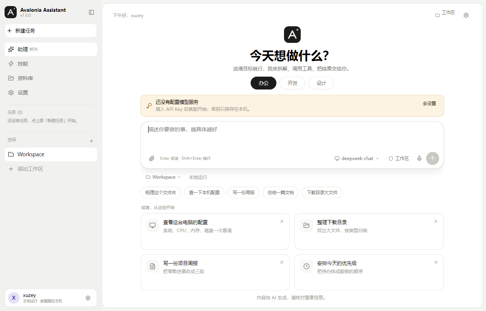
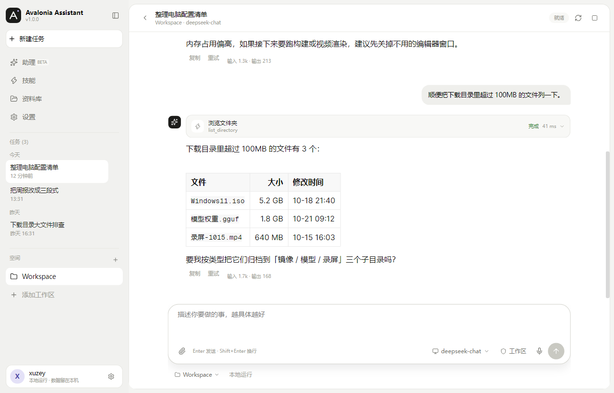
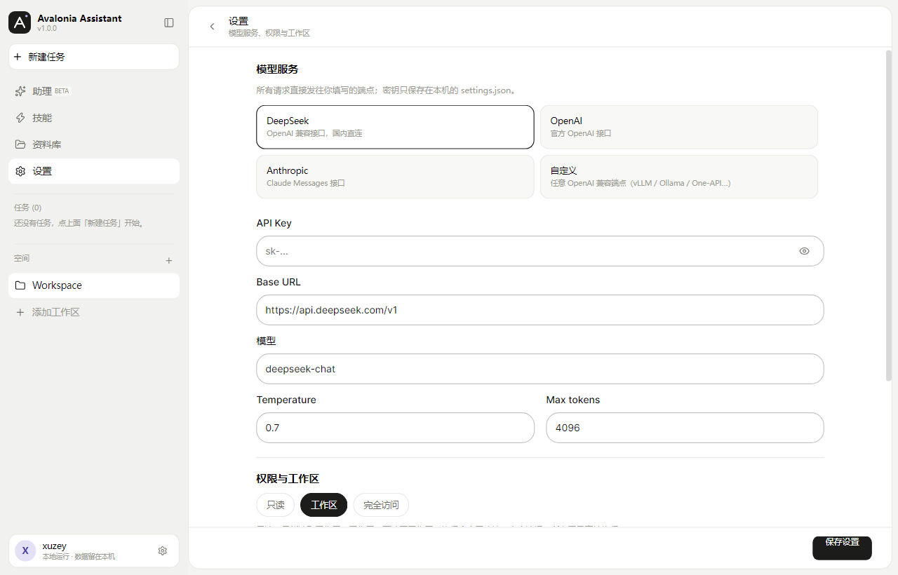
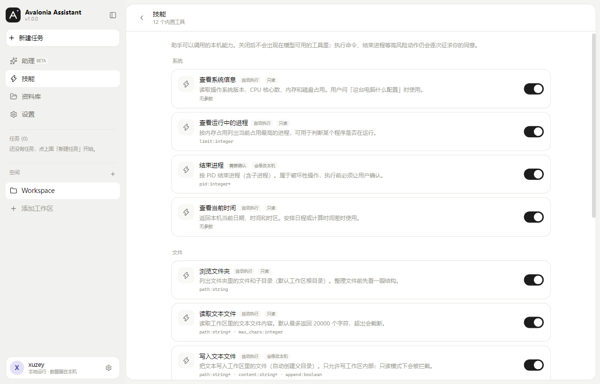
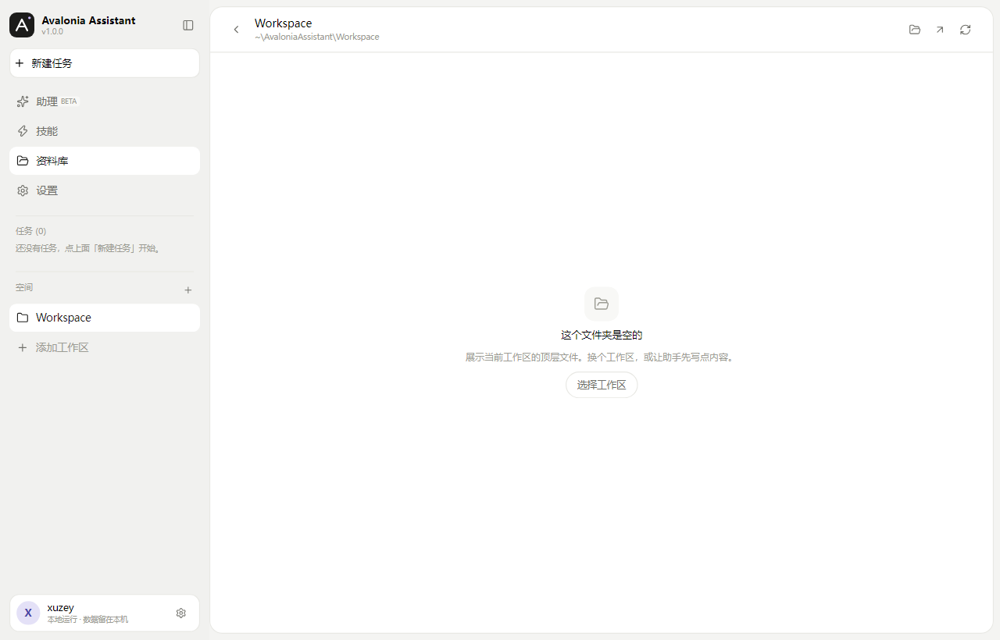

# Avalonia Assistant

Windows 桌面 AI 助理。Agent 循环用 [pi.net](https://github.com/AIDotNet/pi.net)，界面用
[TKCode.Arc](https://github.com/AIDotNet/TKCode.Arc)，交互参考 WorkBuddy：左侧任务与空间，
中间对话，输入框里带模型、权限和工作区选择。



## 现在能做什么

- **流式对话**：DeepSeek / OpenAI / Anthropic / 任意 OpenAI 兼容端点（Ollama、LM Studio、vLLM、One-API）。
- **真的会动手**：12 个本机工具，覆盖系统信息、进程、文件、命令、网页。
- **三档权限**：只读 / 工作区 / 完全访问；执行命令、结束进程会在对话里弹授权卡。
- **工具过程可见**：每次调用都有卡片，参数、结果、耗时、成功/失败可展开。
- **会话留在本机**：一个会话一个 JSON 文件，侧边栏按今天 / 昨天 / 最近 7 天分组。
- **Markdown**：标题、列表、表格、行内代码、代码块高亮。
- **语音输入**：NAudio 录音 + `/audio/transcriptions` 转写（端点需支持）。
- **技能页**：工具可见、可开关，开关持久化。

| 会话 | 设置 |
| --- | --- |
|  |  |

| 技能 | 资料库 |
| --- | --- |
|  |  |

## 两个核心框架

界面用 **TKCode.Arc**，Agent 循环用 **pi.net**，其余选型都是围着这两个补的。

| 层 | 框架 | 引用包 | 版本 |
| --- | --- | --- | --- |
| UI 框架 | [TKCode.Arc](https://github.com/AIDotNet/TKCode.Arc)（AtomUI 生态） | `TKCode.Arc`、`TKCode.Arc.Fonts` | 0.3.0-preview.1 |
| Agent 框架 | [pi.net](https://github.com/AIDotNet/pi.net)（Pi 的 .NET 移植） | `Pi.Agent`（传递引入 `Pi.Ai`） | 1.4.1 |

- **TKCode.Arc 负责界面**：控件、主题、图标字体全部来自 Arc，入口在 `Program.BuildAvaloniaApp`
  里一次装好——`WithArcFonts()` 加 `UseAtomUI(b => b.UseDesktopControls().UseArc())`，
  页面、样式、VM 都在 `AvaloniaAssistant.UI`。
- **pi.net 负责 Agent**：由 `Pi.Agent` 的 `Agent` + `AgentOptions`（`StreamFn` / `Model` /
  `Messages` / `Tools` / `BeforeToolCall`）驱动整条循环，流式事件、工具声明、thinking 都来自 `Pi.Ai`；
  provider 适配、事件映射、工具注册收在 `AvaloniaAssistant.Agent`。
- **两边只在一个地方碰面**：`AvaloniaAssistant.Desktop` 这个组合根。`UI` 不引用 `Pi.Agent`，
  `Agent` 不引用 Avalonia，换掉其中任何一个都不用动另一边。

两个包都直接走 NuGet，不依赖本机参考仓库路径。Arc 包与本地源码的命名空间差异
（`AtomUICommunity` vs `AIDotNet`）及踩坑记录见 [docs/research.md](docs/research.md)。

## 其余技术栈

| 层 | 选型 | 版本 |
| --- | --- | --- |
| 运行时 | .NET | 10.0（`net10.0`） |
| 基础 UI | Avalonia | 12.1.4 |
| 控件库 | AtomUI.Desktop.Controls（Arc 依赖） | 6.2.8 |
| MVVM | CommunityToolkit.Mvvm | 8.4.0 |
| 语音 | NAudio | 2.2.1 |

## 快速开始

要求：Windows 10/11，.NET 10 SDK（在 10.0.401 上验证）。

```bash
dotnet restore
dotnet run --project src/AvaloniaAssistant.Desktop
```

首次启动进入首页，点右上角「设置」或提示条里的「去设置」：

1. 选一个服务商（默认 DeepSeek）；
2. 填 API Key；
3. Base URL 与模型会自动带出，也可以手动改；
4. 保存后回到首页，直接输入任务。

默认配置：

| 服务商 | Base URL | 默认模型 |
| --- | --- | --- |
| DeepSeek | `https://api.deepseek.com/v1` | `deepseek-chat` |
| OpenAI | `https://api.openai.com/v1` | `gpt-4.1` |
| Anthropic | `https://api.anthropic.com` | `claude-sonnet-4-5` |
| 自定义 | `http://localhost:11434/v1` | `qwen3:8b` |

> 自定义端点必须是 OpenAI 兼容的 `/chat/completions`。本地 LLM 不再走 LLamaSharp，
> 用 Ollama / LM Studio 暴露一个兼容端点即可。

### 发布

```bash
dotnet publish src/AvaloniaAssistant.Desktop -c Release -r win-x64 --self-contained false
```

产物在 `src/AvaloniaAssistant.Desktop/bin/Release/net10.0/win-x64/publish/`。

## 项目结构

```
Avalonia-Assistant/
├── Avalonia.Assistant.slnx
├── Directory.Build.props          # net10.0 / 语言版本 / 依赖版本变量
├── Directory.Packages.props       # 集中包版本
├── src/
│   ├── AvaloniaAssistant.Abstractions/   # 契约与 DTO（零依赖）
│   │   ├── IAssistantRuntime.cs          # 运行时、授权、会话、设置、语音接口
│   │   ├── AgentContracts.cs             # 事件、模型、工具描述、运行请求
│   │   ├── ChatSession.cs                # 会话 / 消息 / 工具调用 DTO
│   │   └── AssistantSettings.cs          # 设置、provider 预设、权限
│   ├── AvaloniaAssistant.Agent/          # 唯一认识 pi.net 的项目
│   │   ├── PiAgentRuntime.cs             # Agent 装配、事件映射、abort
│   │   ├── PiStreamFactory.cs            # OpenAI / Anthropic 流式入口
│   │   ├── AgentToolRegistry.cs          # 工具清单 → AgentTool
│   │   ├── SystemPromptBuilder.cs        # 中文系统提示
│   │   └── Tools/                        # 12 个内置工具
│   ├── AvaloniaAssistant.Storage/        # settings.json / sessions/*.json
│   ├── AvaloniaAssistant.Speech/         # NAudio 录音 + 转写
│   ├── AvaloniaAssistant.UI/             # 窗口、页面、VM、样式
│   │   ├── Views/                        # MainWindow / Sidebar / Home / Chat / Tools / Library / Settings
│   │   ├── ViewModels/                   # 命令、会话状态、消息 VM
│   │   └── Styles/                       # Tokens.axaml / AppStyles.axaml
│   └── AvaloniaAssistant.Desktop/        # 入口、DI、Arc 初始化
├── tests/AvaloniaAssistant.Agent.Tests/  # 9 个测试
└── docs/
    ├── research.md               # 两个参考项目的结构与集成方式
    ├── migration.md              # 旧功能逐项盘点与取舍
    ├── architecture.md           # 分层、时序、权限、扩展点
    └── images/                   # README 截图
```

## 分层与解耦

```
UI ──► Abstractions ◄── Agent ──► Pi.Agent
        ▲   ▲
   Storage  Speech
```

- `UI` 不引用 `Pi.Agent`，只消费 `IAssistantRuntime` 与 `AgentStreamEvent`；
- `Agent` 不引用 Avalonia，工具执行结果只返回文本；
- `Desktop` 是唯一同时认识两边的组合根。

想换 Agent 框架：实现 `IAssistantRuntime` 并在 `Program.cs` 替换注册。
想换 UI：`Agent` / `Storage` 不变。详见 [docs/architecture.md](docs/architecture.md)。

## 内置工具

| 工具 | 说明 | 权限 |
| --- | --- | --- |
| `system_info` | OS、CPU、内存、磁盘 | 只读 |
| `list_processes` | 按内存列出进程 | 只读 |
| `stop_process` | 按 PID 结束进程树 | 需确认 |
| `list_directory` | 浏览目录 | 只读 |
| `read_file` | 读文本文件（默认 20k 字符） | 只读 |
| `write_file` | 写工作区文件 | 工作区可写 / 只读拦截 |
| `search_files` | 按文件名或内容搜索 | 只读 |
| `open_path` | 用系统程序打开文件/文件夹 | 只读 |
| `run_command` | 执行 shell 命令（60s 超时） | 需确认 |
| `fetch_url` | 抓网页正文 | 只读 |
| `open_url` | 浏览器打开链接 | 只读 |
| `current_time` | 当前时间与时区 | 只读 |

路径默认限制在当前工作区；要越界需要切到「完全访问」。
`open_path` 不会直接启动 `.exe` / `.bat` / `.ps1` 等可执行文件；需要运行时走 `run_command` 并确认。

## 测试

```bash
dotnet test tests/AvaloniaAssistant.Agent.Tests
```

覆盖：

- Faux 模型驱动的完整 agent 循环与工具调用；
- 只读模式拦截、授权拒绝、缺 API Key；
- 本机 TCP 模拟 OpenAI SSE 端点，验证真实 HTTP 流式与工具声明；
- 文件工具的目录 / 读取 / 越界写入；
- settings / session 的 JSON 往返。

## 截图模式

用于 UI 回归和文档配图，不需要 API Key：

```bash
dotnet run --project src/AvaloniaAssistant.Desktop -- --screenshot out.png --page home
dotnet run --project src/AvaloniaAssistant.Desktop -- --screenshot out.png --page chat
dotnet run --project src/AvaloniaAssistant.Desktop -- --screenshot out.png --page settings
dotnet run --project src/AvaloniaAssistant.Desktop -- --screenshot out.png --page tools
```

`--page chat` 会加载一份内存里的示例会话（不写入 `sessions/`），用来检查消息、工具卡、表格渲染。

还提供一个开发用的自动发送参数，用来跑真实的端到端链路：

```bash
dotnet run --project src/AvaloniaAssistant.Desktop -- --run "用三句话介绍你自己" --screenshot out.png
```

它会加载 `%APPDATA%\AvaloniaAssistant\settings.json`，走完整的 Agent → HTTP → UI → 会话落盘流程。

## 数据目录

```
%APPDATA%\AvaloniaAssistant\
├── settings.json
├── sessions\<session-id>.json
└── Workspace\                  # 默认工作区
```

删除 `sessions\` 下的文件即可清空对应会话。设置页有「打开数据目录」。

## 已知边界

- **API Key 明文保存**在 `settings.json`，目前没有接 DPAPI；不要在共享机器上使用生产密钥。
- **语音转写依赖端点**支持 `/audio/transcriptions`；DeepSeek 官方端点不支持，会给出错误提示。
- **没有定时任务 / 专家市场 / MCP**：导航里暂未提供入口，避免假按钮；扩展点见架构文档。
- **会话不会自动压缩**：长会话会把完整历史带给模型，token 消耗随轮次增长。
- **Windows 优先**：代码里对 macOS/Linux 的路径和 shell 做了分支，但只在 Windows 上验证过。

## 文档

- [两个参考项目的调研与集成结论](docs/research.md)
- [旧项目功能盘点与迁移决定](docs/migration.md)
- [架构、时序、权限与扩展点](docs/architecture.md)

## 许可证

MIT，见 [LICENSE](LICENSE)。
